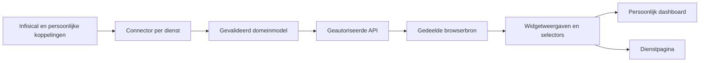

# Codeonderzoek: dubbele functionaliteit en hergebruik

Datum: 18 oktober 2026. Onderzochte basis: commit `b74bd10`.

## Conclusie

ControlDeck heeft al een bruikbare modulaire basis. Verder bouwen op die basis is verstandiger dan opnieuw beginnen. De grootste winst zit in **één gegevenslaag per dienst, gedeelde widgetbouwstenen en pagina's die die widgets samenstellen**. De code hoeft daarvoor niet naar microservices, een Node-server of een zwaar pluginframework.

De belangrijkste overlap zit niet in letterlijk gekopieerde lange functies, maar in dezelfde verantwoordelijkheid die op meerdere plaatsen terugkomt: gegevens ophalen en verversen, verbindingen inrichten, rechten bepalen, instellingen registreren en tegels verplaatsen. De aanbeveling is een reeks kleine verbeteringen met behoud van bestaande gegevens en rechten.

Dit document is onderzoek en een uitvoeringsvoorstel. Er zijn bij dit onderzoek geen providers, accounts, dashboards of productie-instellingen veranderd.

## Herbeoordeling op commit `87bee12` (18 oktober 2026, middag)

Sinds `b74bd10` zijn Files, Virtual Apps (Kasm, VM-status/-wekken), de Proxmox-inventaris (gasten, netwerk, opslag) en de ProxMenux-overzichten toegevoegd. De bevindingen hieronder zijn opnieuw tegen de code gelegd.

| Bevinding | Stand nu | Toelichting |
| --- | --- | --- |
| **Nieuw — P0: upstreamfouten als HTTP 502** | **Bug, eerst oplossen** | Cloudflare vervangt elk origin-502-antwoord door een eigen pagina; de JSON-melding bereikt de gebruiker dan niet ("niet beschikbaar"). Files en Virtual Apps zijn hierop al gerepareerd (status 424, met regressietest). Nog 8 plaatsen: `backend/proxmox.py:312, 322, 339, 364`, `backend/linkwarden.py:153`, `backend/homepage_integrations.py:161`, `backend/cronjob_api.py:42`. Voorstel: één constante/foutklasse `UpstreamError` met status 424 en een regressietest per route. |
| 1. Dubbele ophaal-/ververslussen | **Gegroeid** | Drie nieuwe, vrijwel identieke lussen in `proxmox-guests.tsx`, `proxmox-network.tsx` en `proxmox-storage.tsx` (zelfde `AbortSignal`-, `busy`-, 401/403/409-, `stale`- en `pending ? 5 s`-logica; alleen endpoint en teksten verschillen), plus `virtual-apps-page.tsx`. In totaal 11 `setInterval`-lussen; `/api/proxmenux/summary` wordt door 3 componenten los opgehaald. Een generieke `usePolledResource(fetcher, {interval, fastWhile})` vervangt de drie inventarislussen direct. |
| 2. Vault vóór widgetcache | Ongewijzigd | Virtual Apps leest dezelfde vaultwaarde (`CONTROLDECK_APP_LAUNCHES`) per aanvraag; dezelfde configuratierepository zou beide dienen. |
| 3. Twee Kasm-implementaties | **Opgelost** | `backend/modules/kasm.py` levert `kasm_config`, `kasm_post` (intern `apiUrl` met certificaatpinning) en `linked_user`; aanmelden en Virtual Apps gebruiken beide. Aparte rechten `kasm` en `virtual-apps` zijn behouden. |
| 5. Verspreide HTTP-wrappers | Gegroeid | 25 frontendbestanden doen zelf `fetch`; 19 zetten zelf de CSRF-header. Nieuw sinds de audit: `files.ts`, `virtual-apps.ts`, `page-layouts.ts`. Die drie hebben al een gestructureerde fout (`status`, `relink`, `notLinked`) en zijn een goed model voor `ApiError`. |
| 6. Modulekennis in de hoofdpagina | Gegroeid | `page.tsx` kiest nu tussen 16 routes in één voorwaardelijke expressie. |
| 9. Infrastructuur bij productmodules | Ongewijzigd | `save_private` komt nog uit `linkwarden.py` (gebruikt door `homepage.py` en `files.py`). |
| 10. Autorisatie opnieuw opgebouwd | Gegroeid | 16 plaatsen doen `filter_configuration(load_config(...))` plus een eigen module-ID-zoekactie; nieuw: `files.py`, `page_layouts.py`, `virtual_apps.py`. |
| 11. Backendcaches | Gegroeid | Nieuwe eigen caches in `virtual_apps.py` (workspaces, 60 s) en `vm_power.py` (VM-status 10 s, VM-koppeling 60 s). Ze lossen elk hetzelfde op (TTL + lock), met verschillende vormen. |
| 13. URL-/HTTP-beleid | Gegroeid | Nieuwe validators `nextcloud_origin` (Files) en `workspace_icon`/`connect_url` (Virtual Apps), naast `secure_origin`, `provider_url`, `base_url`, `integration_url` en `display_url`. Terecht verschillende contracten, maar gedeelde fixtures ontbreken. Ook vier eigen HTTP-aanroepfuncties (`files.call`, `homepage_integrations.call`, `linkwarden.upstream`, `widgets.transport.call`) met elk eigen time-outs en foutvertaling. |

**Aangepaste volgorde:** ronde 0 = de 502-bug (klein, gebruikerszichtbaar, met regressietests); daarna ronde 1 (`requestJson`/`ApiError`) en ronde 2 met de generieke `usePolledResource`, waarmee ook de drie nieuwe Proxmox-inventarislussen samenvallen. Ronde 3 (Kasm-client) is vervallen.

## Reikwijdte en bewijs

Repositorybrede inventarisatie van de eigen backend, frontend, scripts, installatie/deployment, configuratiestructuur en tests; verdiepende codelezing van de hieronder genoemde overlap. De inventaris omvat 42 backend-Pythonbestanden (4.980 regels), 77 TypeScript/TSX-bestanden onder `components`, `lib` en `modules` (3.571 regels), de applicatiepagina, 14 eigen scriptbestanden (1.658 regels), 37 Python-testbestanden en 26 frontendtestbestanden. Regelaantallen zijn fysieke regels, geen maat voor complexiteit.

Ook importafhankelijkheden en functie-inhoud van alle backend-Pythonbestanden zijn statisch onderzocht. Vergelijking van identieke AST-functiebodies met minimaal vier statements leverde geen exacte dubbels op. Dat sluit kleinere, bijna gelijke of functioneel overlappende implementaties niet uit.

Gegenereerde bestanden, dependencies, gedownloade mockupbundels, private runtimegegevens en andere werkmappen zijn geen eigen productcode en vallen buiten de inhoudelijke audit. Geen volledige veiligheidspentest, live belastingmeting of nieuwe acceptatietest van alle externe diensten. Prestatiebevindingen hieronder zijn afgeleid uit codepaden, niet uit gemeten productietijden.

## Wat al goed hergebruikt wordt

| Bouwsteen | Huidige toepassing | Advies |
| --- | --- | --- |
| `frontend/modules/service/index.tsx` en `cards.tsx` | Dezelfde serviceweergave op Media en persoonlijke dashboards | Behouden; ophalen losmaken van presenteren |
| `frontend/modules/linkwarden/view.tsx` | Linkwarden op Bookmarks en als dashboardmodule | Behouden; verder opsplitsen in gegevenshook, lijst en beheerformulier |
| `frontend/components/proxmox-summary.tsx` | Clusteroverzicht en dashboardmodule gebruiken dezelfde inhoud | Behouden; dezelfde bron ook aan systeemmeters leveren |
| `frontend/lib/layout-grid.ts` en `components/editable-grid.tsx` | Rasterberekening en bediening voor onder andere Bookmarks en Proxmox | Uitbreiden naar het dashboard |
| `frontend/components/app-icon.tsx` | Favicon, eigen PNG en terugval voor meerdere linkweergaven | Behouden; media-artwork krijgt wel een eigen formaat |
| `backend/dashboard_apps.py` | Gedeelde appverwijzingen voor dashboards en zoeken | Behouden; geen kopieën van appnamen en adressen opslaan in tegels |
| `backend/widgets/transport.py`, `adapters.py`, `presentation.py` | Transport, broninterpretatie en veilige presentatie zijn al gescheiden | Verder uitbouwen, geen tweede integratieplatform ernaast |
| `backend/agent_client.py` | Eén smalle route naar de afzonderlijke SSH-agentproxy | Proces- en rechtenbegrenzing behouden |

## Bevindingen op prioriteit

P1 betekent hier de eerste verbeteringsronde; het is geen classificatie van een beveiligingslek.

### 1. P1 — Dezelfde gegevens krijgen meerdere ophaal- en ververslussen

**Plaatsen:** `frontend/components/proxmox-summary.tsx:22`, `frontend/components/proxmenux-health.tsx:9`, `frontend/modules/system/index.tsx:9`, `frontend/modules/system/metrics.ts:8`, `frontend/modules/service/index.tsx:9`.

CPU- en geheugenmeters roepen allebei `/api/proxmox/summary` aan. Temperatuur en vermogen gebruiken allebei `/api/proxmenux/summary`. Iedere afzonderlijke widget maakt zijn eigen effect, timer en aanvraag. Het Proxmox-overzicht heeft daarnaast een eigen ververslus. De bestaande backendcache beperkt providerverkeer, maar voorkomt deze browseraanvragen, parsing en configuratiecontroles niet.

**Voorstel:** een kleine gedeelde bronlaag met `useResource`/specifieke hooks zoals `useClusterSummary`, `useNodeHealth` en `useServiceSource`. Meerdere widgets abonneren zich op dezelfde bron; selectors maken er afzonderlijke meters van. Deel lopende aanvragen en laat de laatste abonnee de timer opruimen. Gebruik bestaande React-middelen; voeg pas een library toe als de eenvoudige oplossing tekortschiet.

**Bewaken:** identiteit en bronconfiguratie maken onderdeel uit van de bronidentiteit. Bij afmelden of 401/403 moeten gedeelde gegevens verdwijnen. Een tijdelijke storing mag oude gegevens alleen zichtbaar laten met expliciete ouderdom/status. Een ingetrokken recht mag nooit als een tijdelijke storing behandeld worden.

**Bewijs van verbetering:** vier systeemmeters op twee endpoints geven per verversronde twee gedeelde bronaanvragen; gelijke servicewidgets delen een aanvraag. Tests voor normale verversing, laat antwoord na bronwissel, afmelden, ingetrokken rechten, timeout en laatste abonnee weg.

### 2. P1 — Vault lezen gebeurt vóór de widgetcache

**Plaatsen:** `backend/widget_sources.py:58`, `backend/vault.py:46`, `backend/service_widgets.py:35`, `backend/service_widgets.py:68`.

Een widgetaanvraag leest eerst `sources(app)`. `Vault.read()` voert daarvoor een CLI-`list` en een CLI-`run` uit. Pas daarna wordt de 30-seconden-datacache geraadpleegd. Ook bronlijsten en beschermde afbeeldingen lezen deze inrichting. Een cachehit voor media is dus niet automatisch een goedkope aanvraag. Bovendien wordt de moduleconfiguratie opnieuw geladen bij bronautorisatie.

**Voorstel:** eerst één gevalideerde configuratie- en rechtenprojectie per request. Vervolgens een afzonderlijke, begrensde configuratierepository met expliciet ververs-/invalidatiegedrag. Houd geheimen uitsluitend serverzijdig en gebruik de bestaande Infisical-client. Meet CLI-aanroepen voordat een ruimere cache wordt ingevoerd.

**Bewaken:** geen blinde TTL-cache waardoor ingetrokken toegang nog minuten werkt. Rechtenwijzigingen, credentialrotatie en vaultuitval krijgen een expliciet contract. De broncache mag gegevens delen; een positieve gebruikersautorisatie wordt niet onbegrensd meegedeeld.

**Bewijs van verbetering:** tests tellen CLI-aanroepen en bewijzen dat gewijzigde bronrechten en credentials oude cachegegevens niet opnieuw toelaten. Ook lege inrichting, kapotte JSON en vaultuitval worden getest.

### 3. P1 — Kasm heeft twee implementaties van dezelfde basisverbinding

**Plaatsen:** `backend/modules/kasm.py:11`, `backend/virtual_apps.py:35`, `backend/virtual_apps.py:56`, `backend/app_launches.py:13`.

Zowel de aanmeldmodule als Virtual Apps valideren Kasm-origin, API-credentials en de koppeling van ControlDeck-gebruiker naar Kasm-gebruiker. Beide spreken dezelfde publieke Kasm-API aan, met verschillende foutafhandeling en timeouts.

**Voorstel:** één `KasmConnection`/`KasmClient` die configuratie en gebruikerskoppeling valideert. Aanmelden, workspaces tonen, starten en stoppen worden afzonderlijke methoden en afzonderlijk geautoriseerde acties op die client.

**Bewaken:** de loginlink en een workspacelink hebben verschillende toegestane routes; maak daarvoor geen algemene redirectfunctie. Houd ook de huidige rechten `kasm` en `virtual-apps` afzonderlijk totdat een bewuste rechtenmigratie is ontworpen.

**UX:** Kasm als portaal openen en een workspace starten zijn verschillende handelingen. Toon ze onder één herkenbare dienst, met duidelijk benoemde acties. Verwijder niet automatisch een van beide mogelijkheden.

### 4. P1 — Homepage-integraties en servicewidgets vormen twee integratiesystemen

**Plaatsen:** `backend/homepage_integrations.py:14`, `backend/homepage_integrations.py:63`, `backend/widgets/adapters.py:123`, `backend/widget_sources.py:10`, `backend/dashboard_apps.py:13`, `frontend/components/homepage-links.tsx:41`.

Seerr bestaat zowel als Homepage-koppeling met opgeslagen aantallen en versleutelde SQLite-credentials als in de centrale servicewidgetbronnen uit Infisical. De capabilities verschillen: aantallen tegenover aanvragen en artwork. De gedeelde dienstverbinding en authenticatie horen echter niet tweemaal ingericht te hoeven worden. Jellyfin bestaat in het oudere pad en mag bij samenvoegen niet verloren gaan.

Ook de actualiteit verschilt: apptegels gebruiken opgeslagen samenvattingen; servicewidgets halen actuele informatie op. De statusroute van een Homepage-integratie geeft nieuwe aantallen terug, maar schrijft die daar niet terug naar de opgeslagen metadata die de appcatalogus leest.

**Voorstel:** één connector per dienst, met capabilities zoals `summary`, `requests`, `sessions` en `artwork`. Laat een app-link desgewenst verwijzen naar een connector; elke widget kiest een capability en weergave. Migreer bestaande integraties expliciet en gecontroleerd naar vaultreferenties. Bewaar link-ID's, Jellyfin-ondersteuning en huidige rechten. Maak zichtbaar wanneer een getal actueel of oud is.

**Geen automatische migratie:** de oude gedeelde Bookmarks-toegang en de nieuwe expliciete bron-ACL zijn niet hetzelfde. Bepaal per bestaande bron wie toegang houdt; kopieer nooit stilzwijgend alle gebruikers naar een nieuwe bron.

### 5. P1 — HTTP-verzoeken en foutafhandeling zijn verspreid

**Plaatsen:** `frontend/lib/dashboards.ts:27`, `frontend/lib/linkwarden.ts:12`, `frontend/lib/page-layouts.ts:9`, `frontend/lib/service-widgets.ts:49`, `frontend/lib/files.ts:57`, `frontend/components/cronjobs-connect.tsx:7`, `frontend/components/cronjobs-page.tsx:16`.

Veel wrappers herhalen JSON-body, CSRF-header, `no-store`, JSON-parsing en foutmelding. Cronjobs heeft zelfs twee lokale `api`-helpers voor dezelfde API-prefix. Timeout, annulering en foutclassificatie verschillen tussen functies.

**Voorstel:** een kleine geteste `requestJson` met een gestructureerde `ApiError` (`status`, `code`, veilige melding), signaal en optionele validator. Elke module behoudt een dunne wrapper die uitsluitend eigen routes en methoden accepteert.

**Uitzonderingen:** Files-downloads, ruwe uploadchunks en herhaalpogingen krijgen een apart binair/streamingpad. Kasm-start en andere mutaties mogen niet generiek automatisch worden herhaald. De browser mag nooit een willekeurig upstreamadres aan een algemene proxy doorgeven.

### 6. P2 — Modulekennis staat in meerdere registers en in de hoofd-app

**Plaatsen:** `frontend/app/page.tsx:239`, `frontend/modules/registry.ts:8`, `frontend/lib/dashboard-modules.ts:3`, `frontend/lib/service-widgets.ts:1`, `backend/dashboard_modules.py:10`, `backend/widget_sources.py:10`.

Een nieuwe functie vraagt aanpassingen aan de paginakeuze, componentregistratie, dashboardcatalogus en backendvalidatie/rechten. Een deel hiervan is terecht servervalidatie, maar de frontend houdt meerdere catalogi met dezelfde module-ID's en labels bij. De lange voorwaardelijke paginarender maakt uitbreiden en testen onnodig lastig.

**Voorstel:** één frontenddefinitie per functie met pagina, widgets en instellingen. De applicatiepagina beheert alleen sessie, navigatie en de houder. Backendregistratie blijft expliciet en onafhankelijk afdwingbaar. Voeg een contracttest of buildgegenereerde publieke manifestprojectie toe voor overeenkomende ID's, capabilities en instellingenversies; geen dynamische code uit externe diensten laden.

### 7. P2 — Instellingenmodellen zijn aan het dashboard gekoppeld

**Plaatsen:** `frontend/modules/contracts.ts:1`, `frontend/lib/dashboards.ts:5`, `frontend/lib/service-widgets.ts:17`.

`ModuleSettings` wordt afgeleid van `DashboardItem`. Daardoor hangt een herbruikbare module af van het opslagmodel van één specifieke pagina. De dashboardinstellingen zijn bovendien één verzameling optionele velden: een type kan een combinatie van Linkwarden-, systeem- en servicevelden uitdrukken die functioneel nergens bij hoort.

**Voorstel:** onafhankelijke instellingen per widgettype en een getagde union die `widgetId` aan het juiste instellingstype koppelt. Het dashboard bewaart alleen een widgetinstantie met positie en instellingen; de module heeft geen kennis van het dashboard nodig.

`WidgetData` is nu een breed presentatiemodel met optionele velden voor iframe, agenda, download, aanbieding en statistiek. Splits dit stapsgewijs in een gedeelde statusomhulling en getagde resultaten zoals lijst, meting en embed. Alleen domeinvelden toevoegen waar een weergave ze werkelijk nodig heeft.

### 8. P2 — Dashboard en pagina-indelingen hebben twee bedieningen voor hetzelfde raster

**Plaatsen:** `frontend/components/dashboard.tsx:146`, `frontend/components/editable-grid.tsx:11`, `frontend/lib/layout-grid.ts:1`, `backend/dashboards.py`, `backend/page_layouts.py:23`.

Bookmarks en Proxmox gebruiken `EditableGrid`; het dashboard heeft eigen drag/drop-, pointerresize- en toetsenbordlogica. De berekeningen zijn al deels gedeeld via `layout-grid.ts`, maar fixes voor aanraken, slepen of vergroten moeten nog op meerdere plaatsen landen.

**Voorstel:** ook dashboardsecties laten renderen via `EditableGrid`, met aanpasbare rastergrenzen en een adapter voor dashboarditems. Deel backendgeometrievalidatie als kleine pure functie.

**Niet samenvoegen:** de opslagmodellen. Dashboards hebben inhoud, eigenaarschap, secties en revisies; pagina-indelingen beschrijven alleen positie van bestaande inhoud. Hun grenzen verschillen bewust (onder andere maximale hoogte en rijen).

### 9. P2 — Algemene infrastructuur hangt aan specifieke productmodules

**Plaatsen:** `backend/linkwarden.py:52`, `backend/homepage.py:10`, `backend/files.py:20`, `backend/auth.py:169`, `backend/dashboards.py:115`.

Homepage en Files importeren `save_private` uit Linkwarden. Een generieke atomaire bestandsbewerking heeft daarmee een dienstspecifieke eigenaar. De SQLite-contextmanager staat onder authenticatie terwijl veel andere functies hem gebruiken. Schema-initialisatie is verdeeld over auth, dashboards en andere setupfuncties; de dashboardmigratie maakt bijvoorbeeld ook de zoekmachinetabel aan.

**Voorstel:** kleine `storage`-bouwstenen voor private atomaire bestanden, SQLite-verbindingen en expliciete migraties. Dienstspecifieke repositories blijven verantwoordelijk voor hun eigen records. Eén gedocumenteerde migratievolgorde, met backup- en herstarttests.

**Bewaken:** rechten op bestanden/directories, atomaire vervanging, bestaande versleuteling en sleutelafleiding, ID-sequenties en transacties. Maak hier geen algemene ORM-migratie van zonder concrete noodzaak.

### 10. P2 — Autorisatie wordt vaak opnieuw opgebouwd

**Plaatsen:** `backend/proxmox.py:275`, `backend/proxmenux.py:246`, `backend/cronjob_api.py:96`, `backend/widget_sources.py:68`, `backend/app_launches.py:19`, `backend/virtual_apps.py:148`.

Meerdere endpoints laden de configuratie, filteren deze op de account en zoeken vervolgens naar dezelfde module-ID. Dit vergroot de kans op afwijkende foutcodes of rolinterpretatie en herhaalt werk binnen één aanvraag.

**Voorstel:** een requestgebonden `PermissionContext` met `has_module` en `require_manager`, gebaseerd op de bestaande serverprojectie. Bron-ACL en eigenaarschap blijven extra voorwaarden boven op modulerechten. Houd de machine-authenticatie van `/api/widget-ingest` apart van browsersessies.

### 11. P2 — Backendcaches hebben verschillende blokkering en verversing

**Plaatsen:** `backend/proxmox.py:340`, `backend/proxmenux.py:340`, `backend/service_widgets.py:35`, `backend/cronjob_api.py:235`.

De Proxmox-cache houdt één lock vast tijdens providerverkeer; een trage samenvatting kan daardoor ook het takenpad laten wachten. Servicewidgets geven de lock juist vrij vóór het ophalen, waardoor gelijktijdige misses hetzelfde providerverzoek kunnen starten. ProxMenux heeft een uitgebreider patroon met gedeeltelijke achtergrondverversing.

**Voorstel:** een kleine gedeelde cachevoorziening met één lopende fetch per sleutel, begrensde opslag, expliciete ouderdom en invalidatie. Sleutels verschillen per dienst/configuratie. Neem de achtergrond- en gedeeltelijke resultaten van ProxMenux niet weg om alle caches gelijk te maken.

**Bewijs van verbetering:** gelijktijdige aanvragen voor dezelfde bron veroorzaken één fetch; een trage bron blokkeert geen andere bron; credentialrotatie en autorisatieverlies geven nooit oude toegang terug. Gebruik een monotone klok voor interne looptijden.

### 12. P2 — Lokale-linkbeleid zit centraal, maar buiten de React-modellen

**Plaatsen:** `frontend/lib/local-links.ts:10`, `frontend/components/local-link-visibility.tsx:5`, `frontend/components/bookmark-groups.tsx:23`.

De recente globale regel gebruikt een DOM-observer en scant de links opnieuw bij wijzigingen. Dat dekt veel bestaande weergaven tegelijk. Het betekent ook dat groepsaantallen en rasterplaatsen eerst uit de onzichtbaar gemaakte inhoud berekend kunnen zijn. Bij druk verversende widgets wordt meer van de DOM onderzocht dan alleen de gewijzigde widget.

**Voorstel:** dezelfde zuivere URL-/netwerkpolicy gebruiken in een `VisibleLink`/linkprojectie en in de bronselectie van lijsten. Tel zichtbare resultaten en behandel lege groepen bewust. Houd een beperkte compatibiliteitsvangnetfunctie zolang oude modules nog niet zijn aangepast.

**Bewaken:** alleen de zichtbaarheid verandert; opgeslagen documenten en dashboardreferenties blijven bestaan. Deze voorkeur is geen autorisatiegrens. Dit is een uit code afgeleid UX-/onderhoudsrisico, geen gemeten prestatieprobleem.

### 13. P3 — URL- en foutbeleid lijken op elkaar, maar verschillen terecht deels

**Plaatsen:** `backend/modules/launch_urls.py:5`, `backend/files.py:59`, `backend/linkwarden.py:23`, `backend/homepage_integrations.py:21`, `backend/widgets/transport.py:11`.

Er zijn verschillende URL-validators en HTTP-clients. Deel de mechaniek voor parsing, veilige fouten, resourceopruiming en tests. Behoud benoemde beleidsvarianten: publiek HTTPS, intern HTTP met expliciete toestemming, Proxmox-certificaatpinning, ProxMenux-cluster-CA, downloadstream en browserlink zijn verschillende contracten.

Gebruik voor Python en TypeScript dezelfde fixtures met toegestane/geweigerde URL's waar de bedoeling gelijk is. Verwijder de servervalidatie nooit omdat de frontend ook valideert.

### 14. P3 — Vormgeving en statusweergave kunnen een kleine componentbibliotheek worden

**Plaatsen:** `frontend/modules/service/cards.tsx`, `frontend/modules/system/cards.tsx`, `frontend/components/proxmox-summary.tsx`, `frontend/components/proxmenux-health.tsx`, `frontend/components/modal.tsx`.

Meter, statuslabel, laad-/fout-/lege toestand, laatst bijgewerkt en kaartkop hebben verschillende uitvoeringen. Een kleine set `WidgetFrame`, `AsyncState`, `StatusBadge`, `Meter` en `ObjectLink` maakt widgets consistenter. De bestaande `AppIcon` en `Modal` zijn goede voorbeelden van die richting.

Hergebruik tokens/spacing en gedrag; maak niet één allesomvattende kaart met tientallen booleaanse opties. Een filmposter, appicoon en servermeting hebben bewust andere inhoud en afmetingen. Verplaats teksten geleidelijk naar de bestaande vertalingen; veel dienstweergaven bevatten nog vaste Nederlandse teksten.

## Functionele overlap: wat wel en niet samenvoegen

| Huidige functies | Beoordeling | Gewenste uitkomst |
| --- | --- | --- |
| Media-pagina en mediawidgets op Dashboard | Gewenst hergebruik, al aanwezig | Eén weergave en één bronlaag, meerdere plekken |
| Proxmox-overzicht, Proxmox-dashboardmodule en systeemmeters | Gewenste verschillende weergaven, dubbel ophalen | Eén clusterbron met verschillende selectors/widgets |
| Homepage-links en Linkwarden-bookmarks | Twee bewuste bronnen met andere eigenaar/beheer | Dezelfde linkpresentatie; bron duidelijk aangeven; niet stilzwijgend records samenvoegen |
| Homepage-Seerr en Seerr-servicewidget | Gedeeltelijk dubbele koppeling | Eén connector, meerdere capabilities |
| Kasm-portaal en Virtual Apps | Zelfde dienst, andere handeling | Eén client en herkenbare dienst, behoud aparte acties en rechten |
| Nextcloud-openknop, Files en Agenda | Geen functionele dubbeling | Dienstorigin/connectorconcept delen; OIDC, persoonlijke WebDAV-toegang en agenda-ACL onderscheiden |
| Dashboardindeling en vaste pagina-indeling | Zelfde rasterinteractie, andere inhoudsopslag | Raster delen, documenten en revisies apart houden |
| Cronvalidatie in browser, API, proxy en nodeagent | Verdediging op verschillende vertrouwensgrenzen | Alle validators behouden; gedeelde contractfixtures/protocoltests |
| Webservice, agentproxy en root-worker | Bewuste privilegescheiding | Niet samenvoegen om code te besparen |

## Voorgesteld model voor modules en widgets

Gebruik vijf kleine begrippen:

1. **Connector:** één dienstverbinding, server-side credentials/vaultreferentie, capabilities en herkomst van gegevens.
2. **Domeinmodel:** bijvoorbeeld `ClusterSummary`, `DownloadQueue`, `MediaRequest`, `Offer`, `CalendarEvent` of `WorkspaceSession`. Geen dashboardcoördinaten of credentials.
3. **Widgetdefinitie:** type, titel, vereiste rechten, instellingenvalidator, standaardformaat en weergave.
4. **Widgetinstantie:** een verwijzing naar widgettype en bron, plus persoonlijke instellingen. De pagina bezit de plaatsing.
5. **Pagina:** stelt widgets samen en voegt waar nodig beheerhandelingen toe. Een dashboard is één van die pagina's.

De backend blijft op elke aanvraag modulerechten, bron-ACL en waar nodig eigenaarschap controleren. De frontendbronlaag is alleen voor hergebruik en responsiviteit. Pagina's mogen naast widgets ook gespecialiseerde functies bevatten, zoals Files-upload, een terminal of cronbeheer.

De bestaande `frontend/modules/` is een goed vertrekpunt. Voeg daar geleidelijk domeinspecifieke hooks/modellen aan toe en verplaats gedeelde infrastructuur naar kleine `lib`-/`core`-bouwstenen. Verplaats geen bestanden alleen om een ideaal mappenplan te bereiken; verplaats ze wanneer verantwoordelijkheden daadwerkelijk worden losgemaakt.

## Uitvoering in zes reviewbare wijzigingen

| Ronde | Afgebakende wijziging | Gereed wanneer |
| --- | --- | --- |
| 1 | `requestJson`, `ApiError` en één gedeelde Cronjobs-wrapper | Bestaande meldingen/CSRF/routes behouden; JSON-, netwerk- en afwijzingstests slagen |
| 2 | Gedeelde Proxmox-/ProxMenux-bron en selectors voor systeemmeters | Geen dubbele fetch per endpoint/ronde; annulering, bronwissel, afmelden en 403 wissen correct |
| 3 | Gedeelde Kasm-client en configuratievalidator | Portaal, lijst, start en stop blijven werken; vreemde sessies en ongeldige redirects worden geweigerd |
| 4 | Onafhankelijke widgetinstellingstypes en frontendregister; paginahouder vereenvoudigen | Nieuwe widget krijgt één frontenddefinitie; cataloguscontract en bestaande dashboarddocumenten blijven geldig |
| 5 | Dashboard op `EditableGrid`; kleine opslag-/rechtenbouwstenen | Touch/toetsenbord, groepsverplaatsing, grenzen, revisieconflicten, persoonlijke layouts en herstel getest |
| 6 | Connectorconsolidatie van Homepage-integraties/servicewidgets en vaultoptimalisatie | Expliciet migratieplan met backup, stabiele link-ID's, Jellyfin-behoud, bronrechten en credentialrotatie bewezen |

Gemeenschappelijke UI-elementen en lokale-linkprojectie kunnen per aangeraakte functie meelopen; geen grote cosmetische verbouwing vooraf. Iedere ronde moet zelfstandig terug te draaien zijn. Metingen van aanvraag-/CLI-aantallen bepalen of verdere cacheoptimalisatie zinvol is.

## Test- en migratieregels

- Iedere gewijzigde functie krijgt normaal-, grens- en afwijzingsgevallen; daarnaast expliciete sessie-, CSRF-, bron- en eigenaarschapstests.
- Gedeelde transporttests dekken JSON-fouten, veilige foutmeldingen, timeouts en annulering. Files-streams en mutaties houden eigen tests voor grootte, lengte en herhaalbaarheid.
- Gedeelde bron- en cachetests moeten gelijktijdigheid, verouderde antwoorden, laatste abonnee weg, credentialrotatie, logout en ingetrokken toegang aantonen.
- Wijzig bestaande dashboard-/link-/account-ID's niet bij een technische opsplitsing. Een schemawijziging krijgt backup-, bestaande-data-, herstart- en hersteltests.
- Houd de agent en proxy zelfstandig deploybaar en versieer hun protocol. Een gedeelde frontendhelper vervangt nooit de validatie op een node.
- Voer Python-tests, frontendtests, TypeScript-controle en frontendbuild uit vóór iedere push. CI blijft publicatie/deployment blokkeren bij fouten.

## Verificatie van de onderzochte basis

De bestaande controles zijn opnieuw uitgevoerd tijdens dit onderzoek:

| Controle | Resultaat |
| --- | --- |
| `.venv/Scripts/python.exe -m pytest -q` | 718 geslaagd, 8 overgeslagen |
| `npm test` in `frontend/` | 227 geslaagd |
| `npm run typecheck` | Geslaagd |
| `npm run build` | Geslaagd; statische export |
| `git diff --check` | Geen whitespacefouten in de bestaande getrackte diff |

Dit bewijst de huidige regressiebasis, niet dat de voorgestelde refactors al zijn gebouwd of dat alle externe diensten opnieuw live zijn getest. Er zijn alleen dit onderzoeksdocument en de verwijzing in de documentatie-index toegevoegd.
