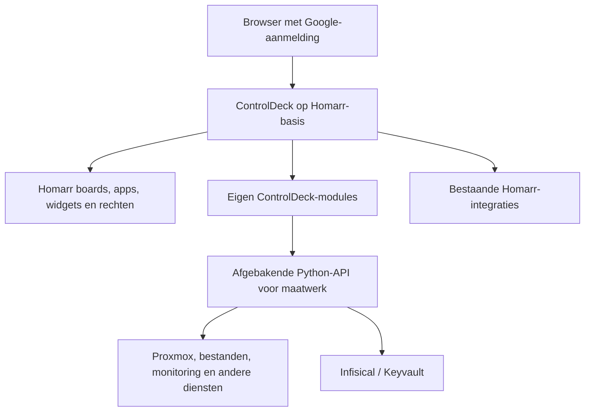

# Plan van aanpak — Homarr als basis voor ControlDeck

Datum: 1 november 2026. Status: richting besloten (volledige vervanging, modules los van Homarr); uitvoering per fase.

Uitvoering: de eigenaar bouwt dit als **controldeskv2** in een aparte repository. De losse
Homarr-site (homarr.vanburik.info) verdwijnt later, inclusief de tunnelroute.

**Besluit 1 november 2026:**
- ControlDeckv2 op basis van Homarr **vervangt uiteindelijk het hele huidige ControlDeck**. Het wordt dus niet alleen
  een startpagina met links.
- De functies van ControlDeck gaan **per functie** over, niet door code of databases samen te voegen.
- **Eigen modules staan los van Homarr,** zodat Homarr-updates eenvoudig blijven.
- Zie [Besluit: volledige vervanging, modules los van Homarr](#besluit-volledige-vervanging-modules-los-van-homarr).

## Richting en doel

De voorkeursrichting van de eigenaar is Homarr als basis nemen en onze eigen
ControlDeck-modules toevoegen. We gebruiken daarmee de bestaande Homarr-editor,
boards, apptegels, containers en widgets in plaats van deze opnieuw te bouwen.
ControlDeck behoudt een eigen naam, logo, huisstijl en aanvullende beheerfuncties.

Dit plan actualiseert de richting uit [PVA-DASHBOARD.md](PVA-DASHBOARD.md).
De eerdere functionele wensen blijven waardevol, maar de daarin gekozen statische
frontend met één Python-service is niet de architectuur van een Homarr-fork.
Dat uitgangspunt moet bij een uitvoeringsbesluit bewust worden aangepast, ook
in AGENTS.md. Dit plan wijzigt die instructies of de applicatie nog niet.

## Onderzoeksbasis

- De vijf screenshots van de eigenaar: vrij plaatsbare apptegels en widgets,
  resizegrepen, containers, doorzoekbare catalogus en een editor met preview.
- `http://w.homarr.home/` antwoordt met HTTP 200 en paginatitel Homarr; CT104
  heeft een actieve Homarr-service en Redis. Bestaande boards en hun instellingen
  zijn in deze inventarisatie niet via een ingelogde sessie uitgelezen.
- De bestaande ControlDeck-code en documenten. Er zijn al persoonlijke boards,
  een raster, opslag met revisies, groepen, modules, zoekfunctie en bronadapters.
  Dit is geen project dat volledig opnieuw vanaf nul hoeft te worden gebouwd.
- De eerdere Homarr-referentiecheckout van 14 oktober is verouderd als startpunt.
  Op 1 november vermeldt GitHub `v2.10.1` als laatste release, gepubliceerd op
  30 oktober. De ontwikkelbranch heet `dev`; de proef moet van een vastgezette
  releasecommit vertrekken, niet van een bewegende branch.
  Gecontroleerde commit van deze tag: `0f0987d2ed013c93ce30c1c00786983d29f4b956`.
- De werkelijke versie van de bestaande CT104-installatie moet nog betrouwbaar
  worden vastgesteld: het aangetroffen workspace-packageveld `0.1.0` is daarvoor
  geen bewijs. Beschikbaarheid van actuele Custom Widgets is dus nog te controleren.

## Wat Homarr levert en wat wij toevoegen

| Onderdeel | Voorkeursaanpak |
| --- | --- |
| Board, raster, slepen, vergroten/verkleinen | Homarr als eigenaar; niet daarnaast een tweede editor bouwen |
| Containers en inklapbare groepen | Bestaande Homarr-werking gebruiken |
| App- en widgetkiezer, preview en instellingen | Homarr-bediening behouden, eigen typen hierin aansluiten waar nodig |
| Downloads, media, weer, klok en standaardintegraties | Eerst bestaande Homarr-functie beoordelen en configureren |
| Google SSO, groepen en boardrechten | Homarr-identiteit gebruiken, rechten gecontroleerd verbinden met eigen services |
| ControlDeck-huisstijl | Centrale tokens vertalen naar Homarr-thema/componenten; gerichte overrides |
| Eigen Proxmox-beheer, monitoring en infrastructuurfuncties | Bestaande Python-code behouden achter afgebakende API's; passende schermen/widgets toevoegen |
| Workfarm | Bestaande dienst koppelen; eerst overzicht/widget en link naar volledige bediening |
| Termix, Kasm en bestanden | Bestaande werking en rechten behouden; aanvankelijk via beveiligde pagina of link |
| Persoonlijke instellingen en bestaande dashboards | Expliciete migratie; niet rechtstreeks databases samenvoegen |
| Infisical/Keyvault | Bestaande secretvoorziening behouden; widgets krijgen verwijzingen en afgeschermde API-toegang |

De scheiding tussen **app**, **integratie**, **widget** en **board** blijft expliciet:
een app is een bestemming; een integratie bevat de verbinding; meerdere widgets
kunnen die gebruiken; een board bewaart indeling en widgetinstellingen. Een API-key
voor gegevensuitwisseling is geen automatische browserlogin.

## Beoogde technische opbouw

Homarr blijft eigenaar van zijn eigen opslag, caching en achtergrondprocessen.
De Python-service blijft in eerste instantie eigenaar van bestaande maatwerkdata
en adapters. We koppelen via API's, niet via directe schrijfacties in elkaars database.
De precieze serverprocessen, opslag- en Redisvereisten worden tegen de gekozen
release vastgelegd voordat de proef wordt gebouwd.

### Uitbreiden zonder onnodige forkverschillen

1. Gebruik standaard Homarr-widgets waar ze voldoen.
2. Onderzoek Custom Widgets voor nieuwe gegevensweergaven en beperkte acties.
   Dit is geen algemeen pluginmechanisme waarmee iedere volledige beheerpagina
   zonder bronwijzigingen kan worden toegevoegd.
3. Gebruik voor uitgebreide bestaande bediening een afgeschermde eigen route
   of gekoppelde service. Controleer iframe-, cookie- en websocketvoorwaarden.
4. Wijzig Homarr-broncode waar een eigen menu, scherm of diepe integratie dat
   vereist. Houd zulke wijzigingen klein en per module herkenbaar.

Voorgestelde organisatie: een afzonderlijke fork met `upstream` naar Homarr en
een eigen remote voor ControlDeck. Leg de uitgangscommit, eigen patches,
thema-aanpassingen en updateprocedure vast. Nog geen fork aangemaakt in deze fase.

## Welke eigen functies moeten behouden blijven?

Voor de proef maken we een actuele matrix met per functie: behouden, standaard
Homarr gebruiken, widget maken, volledige maatwerkpagina behouden of later migreren.

| Functiegroep | Eerste onderzoekspunt |
| --- | --- |
| Proxmox en ProxMenux | Welke bestaande beheeracties ontbreken in Homarr en welke leeswidgets zijn dubbel? |
| Workfarm/Prefect | Compact overzicht versus bestaande volledige workerbediening |
| Bookmarks en Linkwarden | Bestaande appbronnen hergebruiken, dubbele tegels voorkomen, persoonlijke collecties bewaren |
| Kasm en virtuele apps | Persoonlijke accountkoppeling en ondersteunde launch-API behouden |
| Termix | Sessieautorisatie en websocketproxy behouden; geen publiek terminaladres |
| Bestanden/Nextcloud/SMB | Eigenaar, padgrenzen, upload/download en eventuele SSO-routes behouden |
| Cronjobs en monitoring | Alleen toegestane acties; bestaande uitvoer- en beheerrechten niet verruimen |
| Mail, media en servicewidgets | Standaardwidget waar passend; eigen bronadapter alleen bij aantoonbare meerwaarde |

Niet alles hoeft in de eerste proef in Homarr te worden ingebouwd. Het bestaande
ControlDeck blijft bereikbaar totdat vervanging per functie is getest.

## Rechten en geheimen

- Een geslaagde Google-login verleent niet automatisch beheerrechten in alle modules.
- Kies per functie expliciet bekijken, bedienen en beheren. Ontbrekende rechten
  worden door de ontvangende backend gecontroleerd, niet alleen door de knop te verbergen.
- Geen gekopieerde Google-cookies of onbegrensde gedeelde admin-API-key als brug.
- Onderzoek voor de koppeling een ondersteunde, controleerbare identiteitsoverdracht
  of smal begrensde servicecredentials. Leg issuer, audience, scopes en intrekking vast.
- Geheimen blijven in private runtimeopslag/Keyvault; niet in board-JSON, widgetcode,
  URL's, exports, logs of Git. Een native Infisical-koppeling in Homarr is nog niet bewezen.
- Beperk widgetverzoeken tot toegestane doelen en endpoints; geen willekeurige
  proxy naar het interne netwerk.
- Bestaande persoonlijke instellingen worden niet ineens gedeeld omdat een board
  door meerdere gebruikers bekeken kan worden.

## Huisstijl en betrouwbaarheid

Behoud de bedieningswijze van Homarr, maar gebruik de eigen ControlDeck-huisstijl
uit `D:\Project\huisstijl`: kleuren, lettertypen, kaarten, focusweergave en thema's.
Een vertaling naar Homarr/Mantine kan nodig zijn; alleen een CSS-bestand laden
garandeert niet dat alle componenten de tokens volgen.

De lege kaarten, DNS-fouten en dubbele integraties in de screenshots worden niet
als gewenst gedrag overgenomen. De proef toont onderscheid tussen ontbrekende
configuratie, laden, geen gegevens, tijdelijk onbereikbaar, geen rechten en verouderde
gegevens. Een defecte widget mag de rest van het board niet blokkeren. Voor elk
bronadres controleren we bereikbaarheid vanuit de Homarr-server, niet alleen
vanuit de browser.

## Fasering en concrete resultaten

### Fase 0 — ontwerpbesluit en inventaris

Vaststellen van Homarr-versie, benodigde modules, huidige rechten en opslag.
Keuze voor repo-opbouw, rol van de Python-service en thema-aanpak. Maak een
featurematrix en één schets van het gewenste board. Resultaat: klein, toetsbaar
proefontwerp en bijgewerkt architectuurbesluit; nog geen productieomschakeling.

### Fase 1 — afgeschermde proef naast productie

Start van vastgezette Homarr-release in een aparte testomgeving. Eén Homelab-board
met apptegels, een container, een standaard Homarr-widget en een eigen alleen-lezen
Workfarm- of Proxmox-widget via de bestaande backend. Google-login met een beheerder
en een beperkte gebruiker testen. Eigen huisstijl, raster en preview beoordelen.

Resultaat: aantoonbaar Homarr-bediening met echt maatwerk, zonder de huidige
ControlDeck- of Homarr-installatie te vervangen. Geen nieuwe bedienacties in deze fase.

### Fase 2 — eigen modules en beheer

Voeg de gekozen maatwerkpagina's en gecontroleerde acties toe. Rond API-contracten,
Keyvault, persoonlijke instellingen en rechten af. Maak één gedocumenteerd patroon
voor nieuwe modules, zodat niet iedere uitbreiding anders wordt gebouwd.

### Fase 3 — migratie en proefgebruik

Back-up van databases, configuratie en benodigde encryptiesleutels; herstel eerst
testen. Bestaande apps en boards gecontroleerd omzetten. Adressen, groepen,
standaardboards en persoonlijke rechten controleren. Laat beide omgevingen
tijdelijk naast elkaar werken met een duidelijke eigenaar per gegevenssoort.

### Fase 4 — release en onderhoud

Pas de publieke ingang pas aan na acceptatie. Bewaar een geteste terugvalroute.
Iedere Homarr-update eerst in de proefomgeving: database-migraties, API-contracten,
eigen patches, rechten en huisstijl controleren. Een oude image is geen volledige
rollback wanneer de database al naar een nieuw schema is gemigreerd.

## Acceptatiecriteria voor de proef

- De editor gebruikt daadwerkelijk Homarr: apps en widgets toevoegen, verplaatsen,
  vergroten, verkleinen en in een container plaatsen.
- De indeling blijft na opslaan, opnieuw openen en herstart behouden.
- Desktop, mobiel vanaf 375px, toetsenbord en beide thema's zijn bruikbaar.
- Eén native widget en één eigen backendwidget tonen echte, toegestane gegevens.
- De beperkte gebruiker kan geen verborgen brongegevens of beheeractie opvragen.
- Een falende bron of verlopen credential veroorzaakt een lokale widgetfout,
  geen wit of volledig defect dashboard.
- Geen secrets in geëxporteerde boards of browserresponses; back-up en herstel getest.
- Bestaande productie blijft bruikbaar tijdens de proef.

Iedere nieuwe functie krijgt normaal-, grens- en fouttests; authenticatie en
autorisatie krijgen aanvullende tests. Iedere bugfix krijgt een regressietest.
Voor behouden ControlDeck-code blijven pytest, frontendtests, typecheck en build
verplicht. De fork krijgt daarnaast de benodigde Homarr-tests en browsercontroles.
CI blokkeert publicatie en deployment bij mislukte verificatie.

## Licentie en onderhoud

De gecontroleerde Homarr-bron gebruikt Apache-2.0. Bij overname bewaren we de
licentie, toepasselijke notices en vereiste wijzigingsvermeldingen; eigen branding
maakt de oorspronkelijke bronvermeldingen niet overbodig. ControlDeck heeft nu
GPL-3.0. Leg vóór codeovername vast welke code wordt gecombineerd en onder welke
voorwaarden die wordt verspreid; zet niet alle bestaande code stilzwijgend onder
een ander licentielabel. Secrets en persoonlijke configuratie vallen buiten de bronexport.

De voornaamste kosten zitten na de eerste proef in updates en regressiecontrole,
niet in het overnemen van één editorbestand. Daarom beperken we wijzigingen aan
Homarr-kerncode en behouden we maatwerk achter duidelijke module- en API-grenzen.

## Besluit: volledige vervanging, modules los van Homarr

### Uitgangspunt

ControlDeckv2 vervangt het huidige ControlDeck volledig. Homarr blijft daarbij **ongewijzigd upstream**.
Eigen functionaliteit zit ernaast, niet erin. Zo kan een nieuwe Homarr-versie worden overgenomen zonder
conflicten met ons maatwerk.

### Regels voor eigen modules

1. **Geen wijzigingen in de Homarr-kerncode** (`apps/`, `packages/` van upstream). Is een aanpassing onvermijdelijk,
   bijvoorbeeld een ontbrekend uitbreidingspunt? Dan maak je hem zo klein mogelijk en apart herkenbaar, en bied je hem bij
   voorkeur upstream aan. In de repository staat een lijst van zulke afwijkingen. Doel: die lijst leeg houden.
2. **Al ons eigen werk staat buiten de Homarr-mappen:** in `controldeck/` (deployment, scripts, documentatie) en in
   eigen modulemappen. Het samenvoegen van een nieuwe upstream-versie raakt die mappen dus niet.
3. **Een module koppelt alleen via de uitbreidingspunten die Homarr zelf biedt.** Op volgorde van voorkeur:
   - **Instelling:** een standaard-widget of -integratie van Homarr, alleen geconfigureerd.
   - **Iframe- of link-widget:** voor een bestaande eigen webpagina, zoals Workfarm of AgentDeck.
   - **Custom Widget:** volgens het Workshop-formaat, los te installeren en los te versiebeheren.
   - **Eigen API-dienst:** een eigen dienst buiten Homarr, bijvoorbeeld de bestaande ControlDeck-backend in
     Python. Homarr benadert hem via een integratie, een widget of MCP. Logica, rechtencontrole en geheimen blijven in
     die dienst.
4. **Geheimen** blijven in Infisical. Homarr bewaart alleen wat een integratie nodig heeft, versleuteld met
   `SECRET_ENCRYPTION_KEY`. Modules krijgen geen rechtstreekse toegang tot de Homarr-database.
5. **Huisstijl** gaat via het thema en de aanpassingsmogelijkheden van Homarr (kleuren, logo, eigen CSS), niet via
   gewijzigde componenten.
6. **Updateproef bij elke Homarr-versie:**
   - eerst in een proefomgeving: build, databasemigratie, readiness-check;
   - daarna een rooktest per eigen module: laadt hij, en klopt de rechtencontrole?
   - pas daarna op CT 123.

   De samenvoeging met upstream is een aparte PR, zonder modulewijzigingen erin.

### Indeling per functie

| Functie in ControlDeck v1 | Aanpak in ControlDeckv2 | Soort |
|---|---|---|
| Board, tegels, slepen, persoonlijke indeling | Homarr-board-editor | Instelling |
| Gebruikers, groepen, rechten | Homarr-gebruikers en -groepen. Google-login via OIDC (nu nog `credentials`). | Instelling |
| Zoeken | Homarr-zoekfunctie | Instelling |
| Media, Plex, Radarr, downloads | Standaardintegraties en -widgets van Homarr | Instelling |
| Bookmarks en Linkwarden | Homarr-bookmarks of de Linkwarden-integratie. Persoonlijke collecties migreren. | Instelling + migratie |
| Workfarm (Prefect-dashboard) | Iframe-widget naar `/workfarm/` met de bestaande auth_request. Later een compacte statuswidget op de dashboard-API. | Iframe → eigen API-dienst |
| AgentDeck | Iframe- of link-widget naar `https://agentdeck.vanburik.info` (zelfde Cloudflare Access) | Iframe |
| Proxmox en ProxMenux (nodes, VM's, opslag, netwerk, hardware, taken) | Eerst de Proxmox-integratie van Homarr bekijken. Beheeracties en ProxMenux-details via de bestaande Python-backend als API-dienst, met een eigen widget. | Instelling + eigen API-dienst |
| Kasm / virtuele apps | Bestaande launch-logica en persoonlijke accountkoppeling in de API-dienst. Widget of pagina voor het starten. | Eigen API-dienst |
| Cronjobs | API-dienst met de bestaande toegestane acties en rechten. Widget voor status en uitvoeren. | Eigen API-dienst |
| Monitoring (verbindingen, mail) | API-dienst. Homarr-widget voor de status. | Eigen API-dienst |
| Termix (terminal) | Voorlopig beveiligde link naar de bestaande websocket-proxy. Geen publiek terminaladres. | Link, later beoordelen |
| Bestanden (Nextcloud/SMB) | Voorlopig beveiligde link naar de bestaande pagina, met eigenaar- en padgrenzen. Later beoordelen. | Link, later beoordelen |
| Modulebeheer en providers (Admin) | Vervalt grotendeels: integraties zijn in Homarr in te stellen. Infisical-koppelingen blijven in de API-dienst. | Instelling |
| Persoonlijke instellingen en dashboards | Eenmalig migratiescript van ControlDeck v1 naar Homarr, via de Homarr-API, niet via de database | Migratie |

### Overgang

- ControlDeck v1 (CT 164) blijft draaien tot elke functie in ControlDeckv2 is getest.
- Daarna verdwijnt per functie het menu-item in v1.
- Als laatste gaat v1 uit, samen met de tunnelroute en de LXC, na een back-up.
- De Python-backend van v1 leeft voort als de **API-dienst** voor Proxmox, Kasm, cronjobs en monitoring. De
  frontend van v1 vervalt.

## Nog te kiezen bij bespreking

1. ~~Moet de nieuwe Homarr-basis uiteindelijk de hele ControlDeck-shell vervangen?~~ **Besloten:** ja, volledige
   vervanging (zie hierboven).
2. Welke drie eigen modules hebben prioriteit? Voorstel: Proxmox, Workfarm en Kasm.
3. Starten met persoonlijke boards zoals nu, of moet delen direct in de eerste versie?

Deze keuzes veranderen niet de voorkeursrichting: Homarr is de basis. Ze bepalen
hoe groot de eerste proef wordt. Er is in deze planningsstap geen code overgenomen,
productieconfiguratie veranderd of deployment gestart.

## Bronnen

- [Homarr-broncode](https://github.com/homarr-labs/homarr)
- [Release v2.10.1](https://github.com/homarr-labs/homarr/releases/tag/v2.10.1)
- [Homarr-licentie](https://github.com/homarr-labs/homarr/blob/dev/LICENSE)
- [Boards en layout](https://homarr.dev/docs/management/boards/)
- [Custom Widgets](https://homarr.dev/docs/management/custom-widgets/)
- [Integraties](https://homarr.dev/docs/management/integrations/)
- [Bestaande ControlDeck-dashboardfuncties](DASHBOARD.md)
